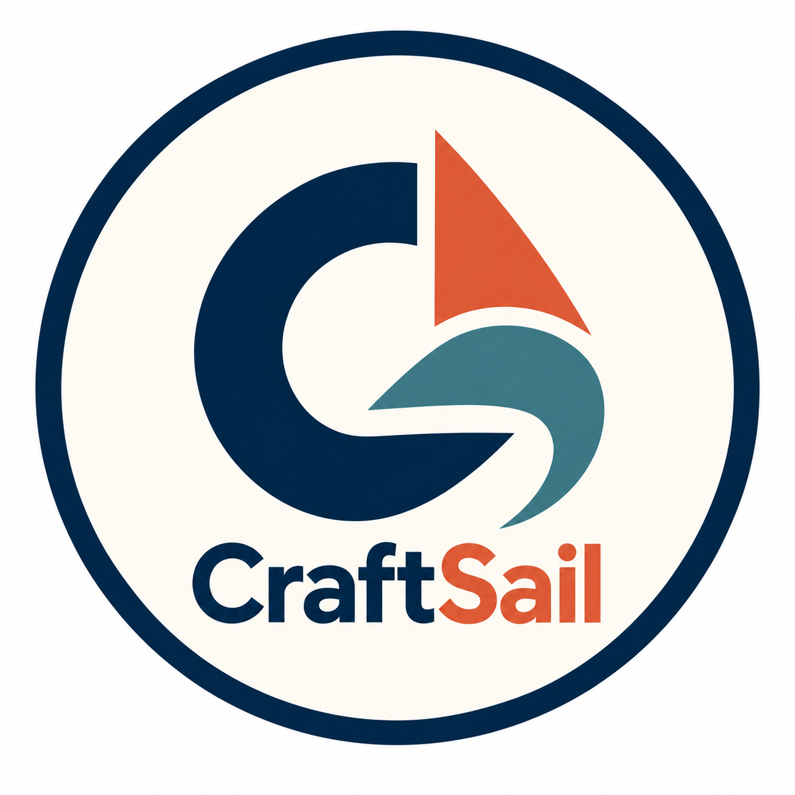

<h1> CraftSail</h1>

<h3>技术很好，运营不行，只是产品死得体面一点</h3>

## 为什么写

能做出来，不等于有人找得到，也不等于有人付钱。

同一个功能，你刚做出来，别人很快就能跟上，甚至做得比你好。不加班就卷不过别人，加班又是个无底洞——典型的囚徒困境。

国内高端岗位少，肯为软件付钱的客户也少。大家挤在一起堆功能、砍价格，利润越来越薄。

要卷，就出去卷。赚海外的剪刀差。

[造物局 CraftSail](https://craftsail.com) 做过的方法，写在这里。能在线上核对的才进目录。

加我进群

## 样本

CraftSail 是面向独立开发者和小团队的 AI / 开发者趋势数据门户。

每一步都应该能在 [craftsail.com](https://craftsail.com) 上打开、用 `curl` 核对。

## 现在可以读

| 章节 | 讲什么 |
| --- | --- |
| [把运营当成一道建模题](growth/把运营当成一道建模题.md) | 引子：技术人为什么转做海外运营，为什么说这是降维打击；用数学建模的办法拆运营——多看、多拆、多试；craftsail-book 和 craftsail-growth 一个学一个练；第一道题「流量从哪里来」 |
| [流量公式与阶段权重](growth/流量公式与阶段权重.md) | 把增长写成公式：Bass 扩散模型拆成「各渠道外部推力 + 口碑内生拉力」，渠道按脉冲 / 线性 / 累积 / 复利四种时间形状建模（残留、饱和、滞后、衰减）；21 个自变量清单、冷启动 / 1→10 / 10→100 三阶段权重表、用自己的数据估权重的方法、可运行的模拟脚本和每个方向的研究路线 |
| [SEO 落地](seo/SEO落地.md) | 独立 URL、真实链接、`<head>`、robots、sitemap、llms.txt；为什么内容站用 Astro 不用 Next.js；Blog 做成带分页的 feed 流，Help 用带 href 的 sidebar |
| [SEO 的监测](seo/SEO的监测.md) | 用 Search Console、GA4、Cloudflare 看抓取、收录、排名、点击、到站和 AI 流量；CTR 曲线、机会点击、收录时长等公式；每天 / 每周 / 每月的节奏和周报模板 |
| [新站的 SEO 监测](seo/新站的SEO监测.md) | 收录 200–1000 页的新站怎么看 GSC 和 GA4：匿名查询、平均排名、小样本 CTR、GA4 阈值哪些不能信；按 sitemap 看索引率，用 URL Inspection API 每天查全站，算收录时长和展示覆盖率；新站版周报，以及什么时候算过了这一关 |
| [GSC 与 Bing 的接入操作](seo/GSC与Bing的接入操作.md) | 后台怎么点：上线前用 curl 自查；GSC 选网域资源、DNS 验证、提交 sitemap、「无法获取」怎么排查、请求编入索引的配额、关联 GA4、用 API 提交 sitemap 和查收录；Bing 从 GSC 导入、提交 sitemap、IndexNow 三种接法、URL Submission 和 API；两边对照表、上线当天清单、上线后每天每周看什么 |
| [Bing 的收录](seo/Bing的收录.md) | 为什么还要管 Bing：桌面份额、Yahoo / DuckDuckGo / Copilot 共用索引、ChatGPT 已基本不靠 Bing、中国流量；Bing 和 Google 收录的差别；上线当天接 Webmaster Tools、sitemap lastmod、IndexNow（带 curl 示例和返回码）、手动提交的真实额度；三种未收录状态和排查顺序；混乱期和托底；AI Performance 报告；新词站的节奏 |
| [小语种搜索引擎的收录](seo/小语种搜索引擎的收录.md) | Google、Bing 之外还要不要接别的搜索引擎：按语言看各国份额（德法西葡、日语只需 Google + Bing，韩语、俄语、土耳其语、捷克语、越南语要另接）；法德的 Ecosia / Qwant 换成欧洲自建索引 Staan；Yandex、Naver、Daum、Seznam、Cốc Cốc 的账号、验证、sitemap、手动提交和后台报告；IndexNow 参与名单；robots.txt 和 WAF 别挡各家爬虫；加新语言时的清单 |
| [AI 推荐的监测](seo/AI推荐的监测.md) | 用户问 AI 时有没有你：抓得到、认得你、推荐你三个阶段；可见性、认知度、声量、引用怎么量，为什么要多次采样和给区间；robots 和各家 AI 爬虫、llms.txt；引用缺口和站外提及；节奏、过关信号和常见误判 |
| [PMF 验证与第一批用户](growth/PMF验证与第一批用户.md) | 刚起步时怎么证明有人真的需要：七级证据链、Mom Test 访谈、手动拉来前 100 个海外 ToC 用户、留存走平、Sean Ellis 40% 调查（带置信区间）、早期定价、PMF 卷宗模板、没过时改哪一层、12 周计划，附参考文献 |
| [工具产品出海运营](growth/工具产品出海运营.md) | 工具类产品从选题到付费的整条链路：选题打分、一句话定位、渠道怎么选、首发清单、激活、留存、定价和收款、分阶段目标、每周实验流程、合规 |
| [工具产品看数据](growth/工具产品看数据.md) | 北极星和指标树、埋点事件表、UTM 规范、渠道质量、激活漏斗、留存队列、MRR 拆分、LTV / CAC、数字掉了怎么查、样本量和置信区间、看板、周报模板、SQL |
| [出海收款](growth/出海收款.md) | 一笔海外的钱从用户刷卡到进国内银行卡要经过收单、打款、结汇、报税四层；MoR 和 Stripe 的区别；按身份选路线：只有大陆身份、有香港身份、有海外公司各能用什么、钱打到哪、税交给谁（税务居民看住所不看证件，个税法第八条的受控外国企业规则）；Creem、Paddle、Dodo、Polar、Lemon Squeezy、Stripe Managed Payments 的费率、中国卖家能不能用、打款方式和现状，同一笔订阅各家实际扣多少；支付宝、万里汇、Payoneer、PayPal、Wise、香港卡怎么把钱拿回国，5 万美元额度管什么；Form 5472 的 $25,000 罚款；境外所得个税自查；Visa VAMP 1.5% 和拒付；App Store / Google Play 抽成；Creem / Paddle 接入步骤和 Webhook 代码，上线清单 |
| [iOS 出海上架：从个人开发者账号到香港公司](growth/iOS出海上架与开发者账号.md) | 只做海外区的 iOS App：个人 / 组织 / 企业账号的区别（没有「美区开发者」这回事，独资经营不算组织）；大陆身份在 Apple Developer App 里注册（¥688）；商店资料、去掉中国大陆区免备案、欧盟 DSA 交易商声明会公开地址和电话；付费协议、W-8BEN（App 销售不预扣美国税）、银行卡 / 万里汇 / 香港账户怎么填、小型企业计划、财务月和到账时间；换成香港有限公司的路线：D-U-N-S、个人转组织原地迁移（Team ID 不变）、W-8BEN-E、每年的周年申报 / 商业登记 / 审计成本；App 转移的条件、Sign in with Apple 60 天迁移窗口、先用别人账号上架的风险；分阶段清单 |
| [iOS 实操：个人付费注册开发者账号，提交第一个 App](growth/iOS个人账号付费与提交App.md) | 照着做的操作手册：大陆身份在 Apple Developer App 里刷身份证、用支付宝 / 微信 / 银行卡付 ¥688（按年自动续订，不能用余额），非大陆身份网页注册必须用本人信用卡，续费和过期的影响；签协议、Xcode 26 / Bundle ID、审核最常卡的几条（删除账号、第三方登录、内购、套壳）；建 App、年龄分级新问卷、去掉中国大陆区、截图尺寸（6.1 英寸 1179 × 2556）、关键词和隐私问卷；Archive 上传、TestFlight、提交审核和被拒后怎么处理；清单 |
| [广告变现接入](growth/广告变现接入.md) | 工具站和内容站要不要挂广告、挂哪家：AdSense、Adsterra、Monetag、Media.net、Ezoic、Journey / Mediavine、Raptive、EthicalAds、Carbon 的门槛、广告形式、分成和结算（2026 年 Ezoic 涨到 25 万月活、Journey 降到 1,000 session、Raptive 降到 2.5 万 PV）；Adsterra 和 AdSense 的区别、能不能一起用，Chrome 按 Better Ads Standards 过滤全站广告；按阶段怎么选；收入怎么算：后台 Impressions / CTR / CPM / Revenue 的含义和公式，为什么有展示收入却是 $0，按国家加权估算月收入，按国家汇总导出数据的 Python 脚本，Adsterra 的起付线、结算周期和记账；AdSense、Adsterra、EthicalAds 的接入步骤和 Astro / Next.js 代码，ads.txt、欧洲 CMP；上线后看什么，以及广告收入和转化损失怎么算账 |
| [目录站与 awesome 列表](growth/目录站与awesome列表.md) | 早期网站提交目录到底值不值：实测多数「免费 dofollow」其实是 nofollow，Google 把低质量目录和换徽章链接列为链接垃圾；真正的价值是少数目录的引荐、新域名被发现、比较页和 AI 推荐的入选资格；五类目录怎么挑、awesome 列表怎么上和自建、三批提交计划、跟踪表、模型参数 |
| [怎么找社区](growth/怎么找社区.md) | 早期找用户聚集的社区：先列词表，再用六种方法找（搜索运算符、竞品引荐来源、SparkToro、平台内搜索、精选列表、关键词监控）；按发帖数、每帖评论、推广规则打分挑 3–5 个；用 HN 和 Stack Exchange 公开 API 量化话题热度；Reddit / HN / Stack Overflow / Discord 的硬规则；以 CraftSail 为例的实测数据 |
| [冷外联](growth/冷外联.md) | 主动给陌生人发邮件和私信：2026 年回复率基准（平均约 3.4%）、跟进和个性化的效果；小产品该找「放大器」而不是终端用户；联系方式哪些能用（不能抓 GitHub 邮箱）、四段式写法和英文模板；Gmail / Yahoo / Microsoft 发件要求、LinkedIn 和 X 的限制；美国、欧盟、英国、德国、加拿大的法律差异；以 CraftSail 为例的计划 |
| [外链建设](seo/外链建设.md) | 目录站以外的外链怎么做：Google 怎么说外链的重要性（Illyes：不是前三，需要很少的链接）和 Ahrefs 的数据（96.55% 的页面没有搜索流量）；垃圾内容政策、sponsored / ugc / nofollow、GitHub 和维基百科等平台的链接类型、网站声誉滥用、disavow 什么时候用；判断外链质量的七个维度；免费小工具、统计页、未加链接的提及、列表文章外联、集成页、记者请求平台（HARO 已关，Qwoted / Featured / Source of Sources）、客座文章、断链建设的具体做法和英文模板；要避开的做法和外链行情；分阶段节奏；检查外链和 rel 的 Python 脚本、跟踪表、常见误判 |
| [SEO 术语表](seo/SEO术语表.md) | SEO、GSC、GA4、CTR、LCP、GEO、SSR 等缩写的英文全称和中文解释，按搜索结果页、抓取收录、页面标签、结构化数据、性能、监测、AI 搜索、前端架构分组 |
| [Google 与 GitHub 的 OAuth 登录](site/Google与GitHub的OAuth登录.md) | 工具站的「Continue with Google / GitHub」怎么接：授权码 + PKCE + state 的完整流程图；两家的授权、换 token、用户信息、撤销地址对照表；Google Auth Platform 里品牌、目标对象（Testing 和发布）、scope、Web 客户端和回调地址怎么填，secret 只显示一次；GitHub 选 OAuth App 还是 GitHub App、回调只能填一个所以 dev / 线上分两个 App、`Accept: application/json` 和出错也返回 200、私密邮箱查 `/user/emails`；不依赖库的 TypeScript 代码和表结构、账号合并的安全边界；Better Auth / Auth.js / Arctic；常见报错和上线清单 |

### 出海账号

X、LinkedIn、Reddit、YouTube、Threads、Bluesky 上的账号怎么从 0 做起来。按建模的办法：先读论文和源码，再搭公式、跑模拟、定阶段权重。

| 章节 | 讲什么 |
| --- | --- |
| [账号增长公式](account/账号增长公式.md) | 篇章的总纲：十条有依据的规律（Kwak 互关率、MusicLab 不可预测、Goel 一层广播、Bakshy 普通影响者、LinkedIn 弱关系实验、SEISMIC 帖子寿命、Buffer 频率和停更、X Premium 和链接）；从 X 2026 年开源代码里读出的真实权重；账号状态方程和交叉点 F\* = D0 / k，可运行的模拟；16 个自变量、A0 / A1 / A2 三阶段的时间分配、硬规则、周表和估参数的方法；CraftSail 的账号计划；这个篇章后续 13 篇的目录 |
| [科技博主的选题雷达](account/科技博主的选题雷达.md) | 科技博主去哪找选题、怎么自动化、怎么提高阅读量：2026 年还能用的数据源（GitHub 7 月关了 star 名单、9 月新增 star 历史接口，OSS Insight 热门 3 月停了，Papers with Code 已关站）；「好玩 / 有价值 / 趋势」三类选题的信号；打分卡和刷星识别（StarScout 约 600 万疑似假 star）；可直接运行的 [topic_radar.py](account/tools/topic_radar.py) 和实测输出；GitHub Actions 每天自动跑；哪些步骤交给机器、哪些必须人做；Upworthy 3 万多组标题实验得出的写法 |
| [科技博主的视频工具箱](account/科技博主的视频工具箱.md) | 做视频的方法论和工具：YouTube 按「每次展示的观看时长」排序，Test & Compare 也按观看时长份额判胜负；Guo 2014 年 690 万次观看研究的 6 分钟坎；Mayer 多媒体学习原则（附独立元分析的折扣）；录屏、剪辑、程序化视频（Remotion / HyperFrames / Manim）、字幕、配音怎么选；Claude Code 和 Codex 的视频 skill（Remotion、HyperFrames 官方 skill，video-use，openai/skills 已弃用改插件）和安装前的安全检查；把方法论写成自己的频道 skill；开源速览、教程、论文讲解三条流水线 |
| [避免同质化：四个内容方法论](account/避免同质化的四个内容方法论.md) | 流水线做久了内容会长得一样：X 源码里的作者去重和负反馈、YouTube 2025 年「不真实内容」政策、广告磨损实验（读者在乎时只有实质变化有用）、生成式 AI 让内容彼此更像（Doshi & Hauser 2024）；四个各管一个维度的方法论——Hero / Hub / Help 管分量和节奏，新闻价值（Harcup & O'Neill 2017）管角度，STEPPS 和 Berger & Milkman 管传播动机，探索与利用（Thompson 抽样）管实验；可运行的 [content_mix.py](account/tools/content_mix.py) 算同质化程度、排下周计划；一个选题一周的四种发法和发前自检 |
| [Reddit 账号](account/Reddit账号.md) | 小工具怎么从 Reddit 拿到用户和收入：和 X 的区别（通行证不是广播台），发帖、评论、长尾三条线；六个小产品的做法和数字（How to Convert 一帖带来首月 800+ 付费、Rybbit 星多付费少、Postiz 每个功能发一次版本、Simple Analytics 监控「alternative」、垂直版块的游戏、GummySearch 死于 API）；2026 年的变化（r/SaaS 60 天限额、官方 CQS 说明、7 月大模型反垃圾、Reddit Pro、RSS 和公开 API 关闭、FTC 评价规则）；养号、找帖、写回复、发帖和找长尾帖的做法；阶段时间分配、周表和模型参数；以 CraftSail 为例的计划 |

## 出海常用网站

书里各篇用到的工具和平台，按用途分类，方便直接点开。怎么用见右边那一列的文章。

### 搜索收录与 SEO

| 网站 | 用来做什么 | 见 |
| --- | --- | --- |
| [Google Search Console](https://search.google.com/search-console) | 看 Google 的收录、展示、点击、排名，提交 sitemap | [GSC 与 Bing 的接入操作](seo/GSC与Bing的接入操作.md) |
| [Bing Webmaster Tools](https://www.bing.com/webmasters) | Bing 的收录和搜索数据，可以从 GSC 一键导入 | [Bing 的收录](seo/Bing的收录.md) |
| [IndexNow](https://www.indexnow.org) | 页面更新后主动通知 Bing 等搜索引擎 | [Bing 的收录](seo/Bing的收录.md) |
| [Yandex Webmaster](https://webmaster.yandex.com) | Yandex 的收录和搜索数据，做俄语、土耳其语市场要接 | [小语种搜索引擎的收录](seo/小语种搜索引擎的收录.md) |
| [Naver Search Advisor](https://searchadvisor.naver.com) | Naver 的站长后台，做韩语市场要接，提交 sitemap 和 RSS | [小语种搜索引擎的收录](seo/小语种搜索引擎的收录.md) |
| [Seznam Webmaster](https://reporter.seznam.cz/wm) / [Cốc Cốc Search Console](https://coccoc.com/search/console/get-your-website-on-coc-coc-search) | 捷克语、越南语市场的站长后台 | [小语种搜索引擎的收录](seo/小语种搜索引擎的收录.md) |
| [PageSpeed Insights](https://pagespeed.web.dev) | 测 LCP、CLS、INP 等性能指标 | [SEO 的监测](seo/SEO的监测.md) |
| [富媒体搜索结果测试](https://search.google.com/test/rich-results) | 检查结构化数据能不能被 Google 识别 | [SEO 落地](seo/SEO落地.md) |
| [Schema Markup Validator](https://validator.schema.org) | 校验 schema.org 结构化数据 | [SEO 落地](seo/SEO落地.md) |
| [Google Trends](https://trends.google.com) | 看关键词的热度和趋势 | [科技博主的选题雷达](account/科技博主的选题雷达.md) |
| [Ahrefs Webmaster Tools](https://ahrefs.com/webmaster-tools) | 免费查自己站点的外链和 SEO 问题 | [外链建设](seo/外链建设.md)、[目录站与 awesome 列表](growth/目录站与awesome列表.md) |
| [Semrush](https://www.semrush.com) | 关键词和竞品分析 | [工具产品出海运营](growth/工具产品出海运营.md) |
| [Similarweb](https://www.similarweb.com) | 估算竞品的流量和来源 | [怎么找社区](growth/怎么找社区.md) |
| [llms.txt](https://llmstxt.org) | 给 AI 读的站点说明文件规范 | [AI 推荐的监测](seo/AI推荐的监测.md) |
| [Qwoted](https://www.qwoted.com) / [Featured](https://featured.com) / [Source of Sources](https://sourceofsources.com) / [MentionMatch](https://mentionmatch.com) | 记者请求平台：回答记者的问题，被媒体引用并拿到外链 | [外链建设](seo/外链建设.md) |
| [SEO Gets](https://seogets.com) / [GSC Wizard](https://www.gscwizard.com) / [SEOTesting](https://seotesting.com) | 基于 GSC 数据的分析小工具 | [新站的 SEO 监测](seo/新站的SEO监测.md)、[SEO 的监测](seo/SEO的监测.md) |

### 数据分析

| 网站 | 用来做什么 | 见 |
| --- | --- | --- |
| [Google Analytics（GA4）](https://analytics.google.com) | 网站流量、来源、转化 | [工具产品看数据](growth/工具产品看数据.md) |
| [Cloudflare](https://www.cloudflare.com) | CDN、DNS，顺带看爬虫和 AI 流量 | [SEO 的监测](seo/SEO的监测.md) |
| [PostHog](https://posthog.com) | 产品分析：埋点、漏斗、留存，可以写 SQL | [工具产品看数据](growth/工具产品看数据.md) |
| [Plausible](https://plausible.io) / [Simple Analytics](https://www.simpleanalytics.com) | 轻量、注重隐私的网站统计 | [工具产品出海运营](growth/工具产品出海运营.md)、[Reddit 账号](account/Reddit账号.md) |
| [Microsoft Clarity](https://clarity.microsoft.com) | 免费的热图和录屏 | [工具产品看数据](growth/工具产品看数据.md) |
| [Amplitude](https://amplitude.com) / [Mixpanel](https://mixpanel.com) | 产品分析 | [工具产品看数据](growth/工具产品看数据.md) |

### 建站

| 网站 | 用来做什么 | 见 |
| --- | --- | --- |
| [Astro](https://astro.build) | 内容站框架，SEO 友好 | [SEO 落地](seo/SEO落地.md) |
| [Starlight](https://starlight.astro.build) / [Docusaurus](https://docusaurus.io) / [Mintlify](https://mintlify.com) | 文档站 | [SEO 落地](seo/SEO落地.md) |
| [Next.js](https://nextjs.org) / [Vercel](https://vercel.com) | 应用框架和部署 | [SEO 落地](seo/SEO落地.md) |
| [Google Auth Platform](https://console.cloud.google.com/auth/clients) | 建 Google 登录的 OAuth 客户端、填回调地址、发布应用 | [Google 与 GitHub 的 OAuth 登录](site/Google与GitHub的OAuth登录.md) |
| [GitHub OAuth Apps](https://github.com/settings/developers) | 建 GitHub 登录的 OAuth App | [Google 与 GitHub 的 OAuth 登录](site/Google与GitHub的OAuth登录.md) |
| [Better Auth](https://www.better-auth.com) / [Auth.js](https://authjs.dev) / [Arctic](https://arcticjs.dev) | 登录和 OAuth 的现成库 | [Google 与 GitHub 的 OAuth 登录](site/Google与GitHub的OAuth登录.md) |

### 发布和目录站

| 网站 | 用来做什么 | 见 |
| --- | --- | --- |
| [Product Hunt](https://www.producthunt.com) | 新产品发布榜 | [工具产品出海运营](growth/工具产品出海运营.md) |
| [Show HN](https://news.ycombinator.com/show) | Hacker News 的作品展示区 | [怎么找社区](growth/怎么找社区.md) |
| [Indie Hackers](https://www.indiehackers.com) | 独立开发者社区，可以发产品和复盘 | [怎么找社区](growth/怎么找社区.md) |
| [BetaList](https://betalist.com) / [Uneed](https://www.uneed.best) / [Peerlist](https://peerlist.io) / [DevHunt](https://devhunt.org) / [Fazier](https://fazier.com) | 发布板和新产品目录 | [目录站与 awesome 列表](growth/目录站与awesome列表.md) |
| [AlternativeTo](https://alternativeto.net) / [SaaSHub](https://www.saashub.com) | 「X 的替代品」比较类目录，长期有流量 | [目录站与 awesome 列表](growth/目录站与awesome列表.md) |
| [There's An AI For That](https://theresanaiforthat.com) / [Futurepedia](https://www.futurepedia.io) / [Toolify](https://www.toolify.ai) | AI 工具目录 | [目录站与 awesome 列表](growth/目录站与awesome列表.md) |
| [G2](https://www.g2.com) / [Capterra](https://www.capterra.com) | 软件评测站，AI 推荐常参考 | [目录站与 awesome 列表](growth/目录站与awesome列表.md) |
| [TrustMRR](https://trustmrr.com) / [Starter Story](https://www.starterstory.com) | 看别人的真实收入和案例 | [流量公式与阶段权重](growth/流量公式与阶段权重.md)、[Reddit 账号](account/Reddit账号.md) |

### 社区

| 网站 | 用来做什么 | 见 |
| --- | --- | --- |
| [Reddit](https://www.reddit.com) | 按兴趣分的版块，找用户和长尾流量 | [Reddit 账号](account/Reddit账号.md) |
| [Hacker News](https://news.ycombinator.com) / [HN 搜索](https://hn.algolia.com) | 技术社区；Algolia 可以搜历史帖子 | [怎么找社区](growth/怎么找社区.md) |
| [Lobsters](https://lobste.rs) | 邀请制的技术社区 | [怎么找社区](growth/怎么找社区.md) |
| [Stack Overflow](https://stackoverflow.com) / [Stack Exchange API](https://api.stackexchange.com) | 技术问答；API 可以量化话题热度 | [怎么找社区](growth/怎么找社区.md) |
| [DEV Community](https://dev.to) / [Hashnode](https://hashnode.com) | 开发者博客平台 | [怎么找社区](growth/怎么找社区.md)、[目录站与 awesome 列表](growth/目录站与awesome列表.md) |
| [Discord](https://discord.com) | 社群聊天 | [怎么找社区](growth/怎么找社区.md) |

### 受众研究和关键词监控

| 网站 | 用来做什么 | 见 |
| --- | --- | --- |
| [SparkToro](https://sparktoro.com) | 查你的受众在哪些网站、账号、播客上 | [怎么找社区](growth/怎么找社区.md) |
| [F5Bot](https://f5bot.com) / [Syften](https://syften.com) / [Octolens](https://octolens.com) | 监控 Reddit、HN 等处的关键词提及 | [怎么找社区](growth/怎么找社区.md)、[Reddit 账号](account/Reddit账号.md) |
| [Google Alerts](https://www.google.com/alerts) | 监控品牌和关键词 | [怎么找社区](growth/怎么找社区.md) |

### 社交账号

| 网站 | 用来做什么 | 见 |
| --- | --- | --- |
| [X](https://x.com) / [LinkedIn](https://www.linkedin.com) / [YouTube](https://www.youtube.com) / [Threads](https://www.threads.com) / [Bluesky](https://bsky.app) | 出海账号的主要平台 | [账号增长公式](account/账号增长公式.md) |
| [Buffer](https://buffer.com) / [Typefully](https://typefully.com) / [Postiz](https://postiz.com) | 定时发帖、多平台发布 | [科技博主的选题雷达](account/科技博主的选题雷达.md)、[Reddit 账号](account/Reddit账号.md) |

### 冷外联和邮件

| 网站 | 用来做什么 | 见 |
| --- | --- | --- |
| [Hunter](https://hunter.io) / [Apollo](https://www.apollo.io) | 查找公开的工作邮箱 | [冷外联](growth/冷外联.md) |
| [lemlist](https://www.lemlist.com) / [Instantly](https://instantly.ai) / [Woodpecker](https://woodpecker.co) | 批量发冷邮件、自动跟进 | [冷外联](growth/冷外联.md) |
| [Google Postmaster Tools](https://postmaster.google.com) | 看发到 Gmail 的邮件信誉和垃圾邮件率 | [冷外联](growth/冷外联.md) |
| [Resend](https://resend.com) / [Loops](https://loops.so) | 产品的事务邮件和营销邮件 | [工具产品出海运营](growth/工具产品出海运营.md) |
| [Tally](https://tally.so) | 表单和问卷 | [PMF 验证与第一批用户](growth/PMF验证与第一批用户.md) |

### 选题和视频

| 网站 | 用来做什么 | 见 |
| --- | --- | --- |
| [GitHub Trending](https://github.com/trending) / [Star History](https://www.star-history.com) / [Trendshift](https://trendshift.io) / [OSS Insight](https://ossinsight.io) | 找热门开源项目和 star 趋势 | [科技博主的选题雷达](account/科技博主的选题雷达.md) |
| [Hugging Face](https://huggingface.co) / [arXiv](https://arxiv.org) | 模型、论文 | [科技博主的选题雷达](account/科技博主的选题雷达.md) |
| [Remotion](https://www.remotion.dev) / [HyperFrames](https://github.com/heygen-com/hyperframes) / [Manim](https://www.manim.community) | 用代码生成视频 | [科技博主的视频工具箱](account/科技博主的视频工具箱.md) |
| [OBS](https://obsproject.com) / [Screen Studio](https://screen.studio) / [Tella](https://www.tella.com) | 录屏 | [科技博主的视频工具箱](account/科技博主的视频工具箱.md) |
| [CapCut](https://www.capcut.com) / [Descript](https://www.descript.com) / [DaVinci Resolve](https://www.blackmagicdesign.com/products/davinciresolve) | 剪辑 | [科技博主的视频工具箱](account/科技博主的视频工具箱.md) |
| [ElevenLabs](https://elevenlabs.io) | AI 配音 | [科技博主的视频工具箱](account/科技博主的视频工具箱.md) |

### AI 搜索

| 网站 | 用来做什么 | 见 |
| --- | --- | --- |
| [ChatGPT](https://chatgpt.com) / [Perplexity](https://www.perplexity.ai) / [Claude](https://claude.ai) / [Gemini](https://gemini.google.com) / [Copilot](https://copilot.microsoft.com) | 检查 AI 回答问题时会不会推荐你 | [AI 推荐的监测](seo/AI推荐的监测.md)、[Bing 的收录](seo/Bing的收录.md) |

### 收款

| 网站 | 用来做什么 | 见 |
| --- | --- | --- |
| [Creem](https://www.creem.io) | MoR，3.9% + $0.40，中国个人可以打款到支付宝 | [出海收款](growth/出海收款.md) |
| [Paddle](https://www.paddle.com) | 老牌 MoR，5% + $0.50，打款到 Payoneer 或电汇 | [出海收款](growth/出海收款.md) |
| [Dodo Payments](https://dodopayments.com) / [Polar](https://polar.sh) | MoR | [出海收款](growth/出海收款.md) |
| [Lemon Squeezy](https://www.lemonsqueezy.com) | MoR，已被 Stripe 收购，新项目不推荐 | [出海收款](growth/出海收款.md) |
| [Stripe](https://stripe.com) / [Stripe Managed Payments](https://stripe.com/managed-payments) / [Stripe Atlas](https://stripe.com/atlas) | 支付处理；Stripe 自己的 MoR；注册美国公司 | [出海收款](growth/出海收款.md) |
| [RevenueCat](https://www.revenuecat.com) | App 内购订阅管理 | [PMF 验证与第一批用户](growth/PMF验证与第一批用户.md) |
| [App Store Connect](https://appstoreconnect.apple.com) / [Apple Developer](https://developer.apple.com) | 上架 iOS App、签付费协议、填税表和银行、看付款报告；开发者账号注册和个人转组织 | [iOS 出海上架](growth/iOS出海上架与开发者账号.md)、[iOS 实操](growth/iOS个人账号付费与提交App.md) |
| [Rewardful](https://www.rewardful.com) | 联盟分销计划 | [工具产品出海运营](growth/工具产品出海运营.md) |
| [万里汇 WorldFirst](https://www.worldfirst.com.cn) / [Payoneer](https://www.payoneer.com) | 收美元、结汇回国内 | [出海收款](growth/出海收款.md) |
| [PayPal](https://www.paypal.com) / [Wise](https://wise.com) / [Mercury](https://mercury.com) | 收款账户；Mercury 是美国公司的线上银行 | [出海收款](growth/出海收款.md) |

### 广告变现

| 网站 | 用来做什么 | 见 |
| --- | --- | --- |
| [Google AdSense](https://adsense.google.com) | 首选的展示广告联盟，没有流量门槛 | [广告变现接入](growth/广告变现接入.md) |
| [Adsterra](https://adsterra.com) / [Monetag](https://monetag.com) | 门槛低、审核快，用来兜底 | [广告变现接入](growth/广告变现接入.md) |
| [Media.net](https://www.media.net) | Yahoo / Bing 的上下文广告 | [广告变现接入](growth/广告变现接入.md) |
| [Journey by Mediavine](https://www.mediavine.com) / [Raptive](https://raptive.com) / [Ezoic](https://www.ezoic.com) | 有一定流量后的高级广告联盟 | [广告变现接入](growth/广告变现接入.md) |
| [EthicalAds](https://www.ethicalads.io) / [Carbon Ads](https://www.carbonads.net) | 面向开发者受众的单个广告位 | [广告变现接入](growth/广告变现接入.md) |

## 相关

- logo: https://github.com/kaankiziltug/logo-design-skill
- 视频：https://github.com/feitangyuan/onetake

- 线上样本：[craftsail.com](https://craftsail.com)
- 产品仓库：[github.com/craftsail/craftsail](https://github.com/craftsail/craftsail)
